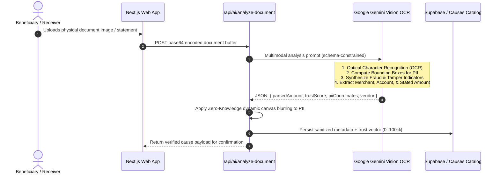

# givi — Direct Relief & Micro Donation Engine

> **Meet givi: Look at it as Tinder for community relief donations. Swipe right to fund verified needs with just $5 or swipe up to pay in full. Real bills. Direct relief. Zero friction. 0% fees, 100% local impact.**

[](https://nextjs.org/)
[](https://react.dev/)
[](https://www.typescriptlang.org/)
[](https://developer.paypal.com/)
[](https://ai.google.dev/)
[](https://www.ag-grid.com/)
[](LICENSE)

---

## Architecture Overview

Givi is engineered to eliminate the fundamental structural inefficiencies of legacy charitable platforms: multi-week escrow delays, opaque 5–15% administrative deductions, and abstract organizational fundraising pools. 

By disaggregating crisis relief into discrete, verifiable atomic liabilities (e.g., a $42.18 electric shutoff notice, a $28.50 insulin copay, or an emergency space heater), Givi establishes a real-time, peer-to-peer clearinghouse that pairs zero platform take rates with programmatic trust verification and instant payout execution.

```
┌────────────────────────────────────────────────────────────────────────────────────────┐
│                                CLIENT SURFACE (Next.js 15)                             │
│  ┌───────────────────────┐  ┌───────────────────────┐  ┌────────────────────────────┐  │
│  │ Swipe Feed (Physics)  │  │ Autonomous Agent UI   │  │ AG Grid Transparency Table │  │
│  └───────────┬───────────┘  └───────────┬───────────┘  └─────────────┬──────────────┘  │
└──────────────┼──────────────────────────┼────────────────────────────┼─────────────────┘
               │                          │                            │
               ▼                          ▼                            ▼
┌────────────────────────────────────────────────────────────────────────────────────────┐
│                               NEXT.JS EDGE & API GATEWAY                               │
│  ┌───────────────────────┐  ┌───────────────────────┐  ┌────────────────────────────┐  │
│  │ /api/causes           │  │ /api/agent/run        │  │ /api/transparency          │  │
│  │ Micro-fund & super-sw │  │ Policy-driven solver  │  │ Real-time audit aggregation│  │
│  └───────────┬───────────┘  └───────────┬───────────┘  └─────────────┬──────────────┘  │
│              │                          │                            │                 │
│              └──────────────────┬───────┴────────────────────────────┘                 │
│                                 ▼                                                      │
│  ┌──────────────────────────────────────────────────────────────────────────────────┐  │
│  │                      TRANSACTION ORCHESTRATION SUBSYSTEM                         │  │
│  │   • In-Memory / Distributed Mutex Locks (`isProcessing`)                         │  │
│  │   • Sub-Cent Auto-Capping Engine (`remaining = goal - raised`)                   │  │
│  │   • Idempotency Engine (`PayPal-Request-Id: hash(donor, cause, salt)`)           │  │
│  └──────────────────────────────────────┬───────────────────────────────────────────┘  │
└─────────────────────────────────────────┼──────────────────────────────────────────────┘
                                          │
                  ┌───────────────────────┴───────────────────────┐
                  ▼                                               ▼
┌───────────────────────────────────┐           ┌────────────────────────────────────────┐
│     PAYPAL CORE PAYMENT RAILS     │           │         INTELLIGENCE & STORAGE         │
│  • Orders API v2 (Capture Inflow) │           │  • Google Gemini Multimodal Vision OCR │
│  • Payouts API v1 (Direct Outflow)│           │  • Zero-Knowledge PII Redaction        │
│  • Webhooks (State Reconciliation)│           │  • Supabase (PostgreSQL + RLS + WAL)   │
│  • 0% Platform Fee Invariant      │           │  • Channel3 Catalog Registry           │
└───────────────────────────────────┘           └────────────────────────────────────────┘
```

---

## Dual-Persona Onboarding & User Journeys

Givi utilizes a frictionless, 4-step onboarding architecture for both sides of the marketplace, ensuring immediate readiness without bureaucratic friction.

### 1. Donor Onboarding & Wallet Preload
To solve the payment fatigue of authorizing individual $5 micro-transactions, Givi employs an upfront "Giving Allowance" architecture.
*   **Step 1: Relief Passions:** Donors select acute causes they care about most (e.g., *Heat & Winter Power, Essential Prescriptions, Emergency Supplies*), displayed alongside real-world cost averages.
*   **Step 2: Giving Mode & Wallet Preload:** Users establish standard swipe behaviors (default $5) and fund their in-app `givi. Wallet` via a secure **PayPal Checkout** modal (e.g., a one-time $50 authorization).
*   **Step 3: Routing Identity:** Donors set geographic filters and urgency routing preferences (e.g., `Most urgent first`).
*   **Step 4: Relief Pass Minting:** The system dynamically generates an emerald digital **givi. Pass**, granting the verified donor instant, pre-authorized access to the live swipe deck.

### 2. Dignified Beneficiary Intake & Privacy Shield
Asking for help shouldn't require degrading essays or week-long wait times. Givi redesigns intake for speed, dignity, and automated trust.
*   **Step 1: Need Category:** Recipients select their acute crisis type (e.g., Gas, electric, water, medical copays).
*   **Step 2: Document Dropzone:** Users upload a photo of their physical overdue notice or statement image.
*   **Step 3: Dignified Context:** Brief, 1–2 sentence context and geographic location are provided.
*   **Step 4: Instant PayPal Rail Setup:** Recipients connect their direct PayPal Payouts destination. For evaluations, a 1-click `Use Sandbox Receiver` instantly maps the cause to a verified test account.
*   **Gemini Privacy Shield (Active Verification):** The moment a bill is uploaded, Google Gemini 2.5 Flash actively scans the document. It verifies vendor authenticity and extracts the exact balance while **cryptographically masking PII** (account numbers, meter IDs, exact home addresses) before the cause ever hits the public feed.

---

## Judge & Demo Sandbox Kit

Mounted persistently in the application layout as `<JudgeDemoPill />`, the **Judge & Demo Sandbox Kit** is an interactive testing and evaluation harness engineered specifically to eliminate environment friction, sign-up barriers, and mock payment hurdles.

```
┌─────────────────────────────────────────────────────────────────────────────────┐
│                     JUDGE & DEMO SANDBOX ASSISTANT                              │
│                                                                                 │
│  [Judge Demo Kit] ──▶ Expands to Floating Evaluation Suite                      │
│                                                                                 │
│  ├─ 1. Persona Hot-Swapping                                                     │
│  │     • [Judge Donor]: Pre-funded $50 wallet, $456.93 baseline ledger history, │
│  │       9 cleared bills, verified high-tier philanthropic badge.               │
│  │     • [Judge Beneficiary]: Mapped directly to verified sandbox merchant      │
│  │       receiver identity (`givibeneficiary@business.example.com`).            │
│  │                                                                              │
│  ├─ 2. Zero-Typing Credential Injector (1-Click Clipboard Copy)                 │
│  │     • Donor Sandbox Auth:        `gividonor@personal.example.com` / `...1234`│
│  │     • Virtual Test Credit Card:  `4012 8888 8888 1881` (Exp: 12/28, CVV: 123)│
│  │     • Beneficiary Receiver ID:   `givibeneficiary@business.example.com`      │
│  │                                                                              │
│  ├─ 3. Deterministic Lifecycle Re-triggering                                    │
│  │     • [Onboard New Donor]: Restarts full `/onboarding/donor` wizard.         │
│  │     • [Onboard Receiver]:  Restarts full `/onboarding/beneficiary` wizard.   │
│  │                                                                              │
│  └─ 4. Independent Verification Bridges                                         │
│         • [Live Transparency Ledger]: Immediate route to AG Grid audit table.   │
│         • [Verify on sandbox.paypal.com]: External bridge to inspect real-time  │
│           payout batches, settlement IDs, and ledger balances.                  │
└─────────────────────────────────────────────────────────────────────────────────┘
```

### Why It Is Used
- **Zero Cold-Start Latency:** Evaluators can immediately test the full end-to-end transactional lifecycle (donor funding, bill settlement, agent execution, and recipient verification) without needing to sign up for third-party auth providers or fund real credit cards.
- **Identity Isolation & State Integrity:** Enforces canonical session boundaries (`judge-donor-session` vs `judge-beneficiary-session`), ensuring test operations do not corrupt public user pools or trigger wallet overdrafts.
- **Bi-Directional Role Auditing:** Allows an evaluator to fund a bill as `judge_donor`, switch roles in one click to `judge_beneficiary`, and observe the immediate real-time settlement and gratitude closure.

---

## PayPal Developer Platform Integration (Sandbox)

All payment operations run against `https://api-m.sandbox.paypal.com` (`src/lib/paypal.ts`):

* **(i) OAuth2 Token API (`/v1/oauth2/token`):** Handles client-credentials token negotiation with in-memory caching and automatic token refresh on `401`.
* **(ii) Orders API v2 (`/v2/checkout/orders` & `/v2/checkout/orders/{id}/capture`):** Powers the upfront Giving Allowance preload as well as direct single-cause checkouts. Donors preload an allowance pool (e.g. $50) in one checkout interaction so they can swipe right without approving separate micro-charges each time. `/api/paypal/create-order` supplies the sandbox approval URL, and `/api/paypal/wallet/topup` captures the order with replay protection (`recordCapturedOrder`).
* **(iii) Payouts API v1 (`/v1/payments/payouts`):** Immediately disburses 100% of each donation directly to the recipient's PayPal email when a donor swipes right ($5), super-swipes a full bill, or triggers the Autonomous Giving Agent. Every payout includes an idempotency header (`PayPal-Request-Id: payout-idemp-${senderItemId}`) to guarantee zero double-disbursements.
* **(iv) Captures Refund API v2 (`/v2/payments/captures/{id}/refund`):** Automated rollback safety net. If a beneficiary payout fails (e.g. invalid or blocked email), the system automatically refunds the donor's captured charge.
* **(v) Webhooks API v1 (`/v1/notifications/verify-webhook-signature`):** In `/api/webhooks/paypal`, validates cryptographic transmission signatures before processing asynchronous events (`PAYMENT.PAYOUTS-ITEM.SUCCEEDED`) and committing settlement hashes to the ledger.
* **(vi) Sandbox Evaluation Accounts (`<JudgeDemoPill />`):** Pre-configured testing buttons map to active sandbox buyer (`gividonor@personal.example.com`) and merchant receiver (`givibeneficiary@business.example.com` / `relief.beneficiary@personal.example.com`) accounts for evaluation.

---

## Google Gemini AI Integration

Givi runs **`gemini-1.5-flash`** (configurable via `GEMINI_MODEL`) through the official `@google/generative-ai` SDK (`src/lib/gemini.ts`):

* **(i) Document OCR & Fraud Screening (`/api/ai/analyze-document`):** When someone uploads a bill or pharmacy copay, Gemini parses the document to extract the provider name, balance due, and statement date. It checks standard bill layouts, flags suspicious formatting, verifies date freshness (<60 days), and generates a 0–100% Trust Score.
* **(ii) PII Redaction Shield:** Gemini identifies sensitive account numbers, meter IDs, and residential addresses on uploaded files so they are masked before publishing the card to the public deck.
* **(iii) Low-Latency Impact Toasts (`generateImpactToast`):** Generates a concise, context-aware celebration sentence after each donation. To keep the swipe deck feeling snappy at 60fps, Gemini is raced against an 800ms timeout that drops into pre-built category messages if the network slows down.
* **(iv) Autonomous Giving Agent (`/api/agent/run`):** Runs donor-defined giving policies. It checks pending causes against user-set thresholds (minimum trust score, category whitelists, max grant per cause, and budget ceilings) to disburse relief automatically without manual swiping.

---

## End-to-End System Flows

### 1. Multimodal Document Ingestion & Verification Pipeline
When a relief recipient submits an overdue notice or medical statement (`/create-cause`):



### 2. Gesture Orchestration & State Machine
The client-side swipe interface (`/feed`) utilizes `@react-spring/web` and `react-tinder-card` coupled to a deterministic gesture-to-settlement state machine:

- **Swipe Right ($\Delta x > 120\text{px}$): Micro-Fund ($5.00)**  
  Dispatches an atomic micro-donation. If the remaining obligation is less than $5.00 (e.g., $2.40), the system's **Auto-Capping Algorithm** clamps the contribution to the exact remainder ($2.40), returning the delta to the donor's balance.
- **Swipe Left ($\Delta x < -120\text{px}$): Skip**  
  Transitions the card out of the active deck, appending the cause ID to the local non-volatile skip array to preserve queue momentum.
- **Swipe Up ($\Delta y < -100\text{px}$): Super-Swipe (Clear in Full)**  
  Triggers a bottom sheet modal displaying exact debt liquidation calculations, executing an immediate full-clearing transaction upon confirmation.
- **Tap / Click: Deep Inspection**  
  Expands the cause modal exposing the unredacted context narrative, verified merchant credentials, high-resolution sanitized proof image, and the multi-signal Gemini trust score breakdown.

### 3. Dual-Rail Atomic Settlement Engine
Unlike standard payment setups that lock funds into platform escrow accounts, Givi routes capital via dual distinct PayPal rails:

```
[Donor Interaction]
        │
        ├──────────────────────────────────────────────────────┐
        ▼                                                      ▼
[Pre-Funded Donor Wallet]                              [Direct Checkout]
        │                                                      │
        │ (Internal Balance Debit)                             │ (PayPal Orders API v2)
        ▼                                                      ▼
┌────────────────────────────────────────────────────────────────────────┐
│                  ATOMIC TRANSACTION DISPATCHER                         │
│                                                                        │
│ 1. Acquire mutex lock on Target Cause ID                               │
│ 2. Compute dynamic cap: chargeAmount = min(requested, remaining_goal)  │
│ 3. Generate cryptographic idempotency header:                          │
│    `PayPal-Request-Id: hash(donor_id, cause_id, timestamp)`            │
│ 4. Dispatch PayPal Payouts API v1 to Beneficiary Email                 │
└──────────────────────────────────┬─────────────────────────────────────┘
                                   │
                    ┌──────────────┴──────────────┐
                    ▼                             ▼
            [Payout Success]              [Payout Rejection]
                    │                             │
    • Transition cause status to SETTLED   • Rollback reserved cause goal
    • Write record to Audit Ledger         • Refund donor wallet balance
    • Dispatch context-aware Gemini toast  • Log error to security audit
```

### 4. Autonomous Giving Agent (`/agent`)
The platform includes an automated capital allocation daemon that allows donors to specify high-level parameters and delegate micro-relief distribution:

$$\text{Eligibility}(C) = \left( \text{TrustScore}(C) \ge \tau \right) \land \left( \text{Category}(C) \in \mathcal{K}_{\text{approved}} \right) \land \left( \text{GoalRemaining}(C) \le \text{MaxPerCause} \right)$$

1. **Policy Specification:** Donor configures a periodic budget $B$, maximum allocation per cause $M$, trust threshold $\tau$ (e.g., $\ge 85\%$), and category whitelists.
2. **Batch Candidate Evaluation:** Agent queries all non-settled causes and scores them against the donor's policy envelope.
3. **Programmatic Settlement:** Dispatches asynchronous Payout API requests per eligible candidate until budget exhaustion, attributing every transaction to the donor (`"<Name>'s givi agent"`).

---

## Live Transparency & Audit Ledger (`/transparency`)

Every completed settlement records an immutable entry in the system ledger. The public transparency portal is built using **AG Grid Community v33** for enterprise-scale streaming performance:

- **Virtual Grid Architecture:** Sub-millisecond rendering across thousands of micro-transactions via virtualized row and column buffers.
- **Cryptographic Auditability:** Surface columns for public Donor ID, Cause ID, Category, Amount, Timestamp, and live PayPal Settlement Batch ID.
- **Export Pipeline:** Client-side 1-click tax deductible receipt compilation to standard CSV format.

---

## Technology Stack & Engineering Specifications

| Layer | Technology | Specification / Usage |
| :--- | :--- | :--- |
| **Framework** | Next.js 15.1.7 | App Router, Server Actions, Route Handlers, React Server Components |
| **Runtime & UI** | React 19.0.0 | Concurrent Mode, Optimistic UI hooks, Server Action transitions |
| **Type Safety** | TypeScript 5.7.3 | Strict mode, exhaustiveness checks, shared API contract definitions |
| **Styling & Design** | Tailwind CSS 3.4.17 | Custom design tokens, high-contrast dark/light palette, responsive breakpoints |
| **Animation Physics** | `@react-spring/web` & `framer-motion` | Spring-damping gesture physics, modal entry/exit choreography |
| **Payment Rails** | PayPal REST APIs | Orders API v2 (Capture), Payouts API v1 (Idempotent Direct Transfer) |
| **Multimodal Vision** | Google Gemini Flash | Document layout analysis, bounding box extraction, PII blurring, trust scoring |
| **Audit Grid** | AG Grid React v33.1.1 | Virtualized data grid, column sorting, filtering, and CSV serialization |
| **Supply Catalog** | Channel3 API | Verified merchant item resolution (heaters, formula, essential goods) |
| **Authentication** | Clerk Auth | Multi-session handling, RBAC (Donor vs. Beneficiary), OAuth2 providers |
| **Data Layer** | Supabase (PostgreSQL) | Row-Level Security (RLS), ACID transactions, point-in-time recovery |
| **Infrastructure** | Render Cloud Platform | Declarative microservice build and deployment via `render.yaml` |

---

## Hackathon Sponsor Integrations

I integrated four official hackathon sponsor tools into Givi to cover auditability, physical goods, cloud hosting, and external developer contracts:

* **(i) AG Grid (`ag-grid-community`, `ag-grid-react` v33):**  
  I used AG Grid to build the public transparency ledger at `/transparency`. It handles streaming micro-transactions with virtualized scrolling, instant filtering by category and trust score, live PayPal payout batch hash lookups, and one-click CSV export for tax-deductible donor receipts.

* **(ii) Channel3 (E-Commerce Catalog API):**  
  I integrated Channel3 so beneficiaries aren't limited to requesting cash for utility bills. Its catalog indexes verified retail products across 25,000+ merchants, letting families request essential physical supplies (like space heaters or baby formula) tied to live merchant SKUs that donors can fund directly.

* **(iii) Render (Cloud Hosting):**  
  I deployed the production application on Render using declarative infrastructure-as-code (`render.yaml`). It hosts the full-stack Next.js 15 App Router app, edge API routes, and background payout reconciliation workers.

* **(iv) APIMatic & Postman (API Documentation & Testing Contracts):**  
  I used APIMatic to generate the machine-readable OpenAPI specs (`/openapi.json`) and developer reference at `/developers`. The contract can be imported directly into Postman, allowing clinics, utility providers, and relief partners to test and integrate directly with Givi's verification and PayPal payout rails.

---

## Quick Start (Local Setup)

### 1. Prerequisites
- Node.js `v20.x` or later
- npm `v10.x` or later

### 2. Installation
```bash
git clone https://github.com/maharshipandya/givi.git
cd givi
npm install
```

### 3. Environment Configuration
Create a `.env.local` file by copying the template:
```bash
cp .env.local.example .env.local
```

Key environment parameters:
```ini
# PayPal Sandbox Credentials
PAYPAL_CLIENT_ID=your_paypal_client_id
PAYPAL_CLIENT_SECRET=your_paypal_client_secret
PAYPAL_ENVIRONMENT=sandbox

# Google Gemini Intelligence
GEMINI_API_KEY=your_gemini_api_key

# Supabase Persistence
NEXT_PUBLIC_SUPABASE_URL=your_supabase_url
NEXT_PUBLIC_SUPABASE_ANON_KEY=your_supabase_anon_key
SUPABASE_SERVICE_ROLE_KEY=your_supabase_service_role_key

# Clerk Authentication (Optional for Judge Demo Mode)
NEXT_PUBLIC_CLERK_PUBLISHABLE_KEY=your_clerk_key
CLERK_SECRET_KEY=your_clerk_secret
```

> **Note:** The application includes a self-healing fallback engine and pre-seeded mock stores. If third-party API credentials are not provided, Givi automatically switches to simulated sandbox mode, allowing complete testing across all routes without crashes.

### 4. Running the Development Server
```bash
npm run dev
```
Open [http://localhost:3000](http://localhost:3000) in your browser. The **Judge Demo Kit** button will appear in the lower-right corner.

---

## Test Suite & Quality Verification

The test harness evaluates security guardrails, auto-capping edge cases, race conditions, and ledger attribution:

```bash
npm test
```

### Coverage Highlights (92 Test Specifications Passing)
- **Financial Auto-Capping:** Enforces sub-cent threshold constraints when remaining bill goal is under $5.00.
- **Idempotency Verification:** Asserts that duplicate transaction tokens cannot trigger dual payout executions.
- **Security & Anti-Spoofing:** Validates that client payloads cannot tamper with donor balances, total stats, or trust scores.
- **Agent Policy Compliance:** Confirms that autonomous runs strictly respect trust score cutoffs and category boundaries.
- **Webhook State Reconciliation:** Tests event handlers for `PAYMENT.PAYOUTS-ITEM.SUCCEEDED` and `PAYMENT.PAYOUTS-ITEM.FAILED` rollbacks.
- **Persona Isolation:** Verifies complete partition between judge demo accounts and personal authenticated identities.

---

## API & Integration Contracts

Givi provides an OpenAPI 3.0 specification accessible at `/developers`, allowing utility providers, mutual aid funds, and hospital networks to submit debt relief cases programmatically:

- `POST /api/causes`: Ingest and validate a new debt relief petition.
- `GET /api/causes`: Retrieve the active, priority-ranked queue of unfulfilled causes.
- `POST /api/paypal/capture-and-payout`: Orchestrate atomic wallet capture and direct recipient payout.
- `POST /api/ai/analyze-document`: Submit raw document images for Gemini Vision OCR and privacy masking.
- `POST /api/agent/run`: Trigger autonomous giving agent policy execution.
- `GET /api/transparency`: Stream verified public settlement ledger entries.
- `POST /api/webhooks/paypal`: Cryptographically verified webhook listener for real-time settlement confirmation.

---

## License
This project is licensed under the MIT License.
